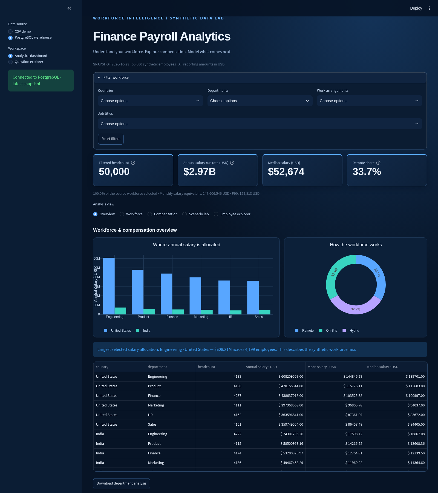
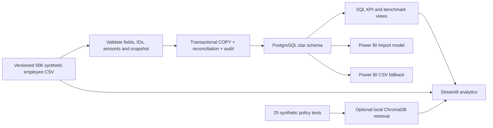
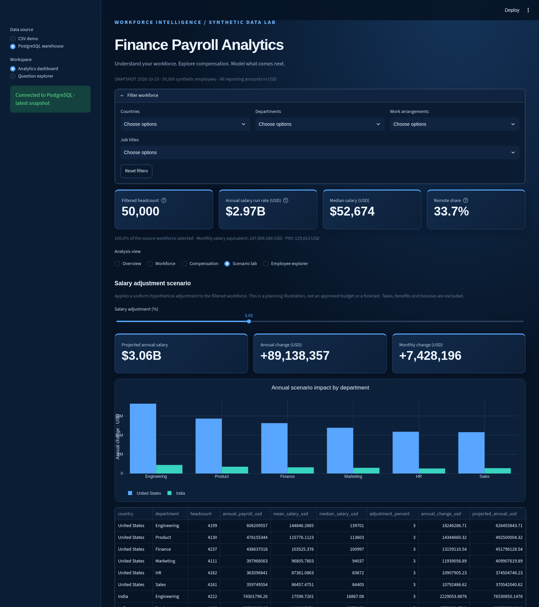

# Payroll & Workforce Analytics

A reproducible analytics project over **50,000 synthetic employees** (25,000 US and 25,000 India), with a **PostgreSQL star schema**, transactional ETL, SQL reporting views, a Streamlit analytics dashboard, and **Power BI Desktop integration files**.



## What you can analyze

- Headcount, annual salary run rate, monthly salary equivalents, median and P90 salaries.
- Department/country salary allocation and workforce composition by city and work arrangement.
- Country-and-department salary benchmarks and IQR review candidates.
- Reconciled source-to-warehouse counts and totals, load provenance and repeatable refreshes.

The fixture is **one synthetic snapshot**, not real payroll payments. Salary run rate excludes benefits, taxes, bonuses and overtime. Monthly equivalents are annual salary / 12. There are no valid turnover, budget variance or historical trend measures in this data. See [metric definitions and limitations](docs/analytics-design.md) and [reproducible findings](docs/analytics-findings.md).

## Architecture



Fact grain: **one employee at one compensation snapshot**. Department, location, employee and snapshot dimensions support one-to-many joins. Current-reporting views and the Power BI fact import select only the latest loaded snapshot. Employee descriptive attributes use Type 1 updates; this is not a complete historical HR warehouse.

## Quick start: PostgreSQL + dashboard

Requirements: Python **3.12**, Docker with Compose. From the repository root:

```bash
python -m venv .venv
source .venv/bin/activate
python -m pip install -r requirements-dev.txt
python -m etl.dev_database
python -m etl.warehouse
python -m etl.bi_reader
python -m etl.export_bi
python -m streamlit run app/dashboard.py --browser.gatherUsageStats false
```

On Windows PowerShell activate with `.venv\Scripts\Activate.ps1`, or invoke `.venv\Scripts\python.exe` directly. Docker Desktop must be running.

Existing Streamlit Community Cloud deployments using `RESPONSIVE_PREMIUM.py` remain compatible: that small entry point forwards to `app/dashboard.py`. New deployments should select `app/dashboard.py`.

Select **PostgreSQL warehouse** in the dashboard sidebar. **Analytics dashboard** provides filters, KPIs, charts, department exports and review candidates. **Question explorer** retains the limited keyword/regex search interface; examples: `Top 10 in USA`, `Engineering in India over 20k`. This interface does not call an LLM or generate SQL. **CSV demo** works without starting PostgreSQL.

The local PostgreSQL service uses port **15432**, database `payroll`, a named volume, and a random password stored only in ignored `.env` with restricted permissions. The reporting helper creates a separate **read-only** `payroll_bi_reader` role. No credentials are tracked or printed. CORS and XSRF protection retain Streamlit defaults.

For your own PostgreSQL service, configure `PAYROLL_DATABASE_URL` securely (SQLAlchemy `postgresql+psycopg` URL); it takes precedence over `.env`. Run `python -m etl.warehouse` with a dedicated development database and schema-creation permissions. The loader owns schema `payroll_analytics`, replaces facts only for the selected snapshot, and updates dimensions. Do not point it at an unrelated production warehouse.

## Streamlit analytics workspaces

The app uses a consistent **dark navy and blue** theme, matching chart surfaces, readable KPI cards and an expanded source/navigation sidebar. Shared country, department, work-arrangement and job-title filters apply to each analytics view; Reset filters restores the full workforce.

| View | What it provides |
|---|---|
| Overview | Filtered KPIs, department salary allocation, work-arrangement mix, a descriptive finding and department CSV export |
| Workforce | City headcount, department/work-arrangement composition, job-title counts and profile export |
| Compensation | Department salary distributions, a median salary heatmap and downloadable IQR review candidates using full-snapshot country/department benchmarks |
| Scenario lab | A hypothetical salary adjustment for the filtered workforce, with annual/monthly cost changes and department-level scenario export |
| Employee explorer | Literal ID/job-title search, salary-range filtering, sorting, 100-row pagination and the complete matching employee export, excluding names/emails |

The scenario does not modify employee records, PostgreSQL or the source CSV. It excludes taxes/benefits/bonuses and is a planning illustration, not an approved budget or forecast. Empty filter combinations are handled explicitly. Preview limits do not truncate CSV exports.



## PostgreSQL model and ETL

- `sql/warehouse.sql`: constrained dimensions/facts, indexes, audit log, KPI and benchmark views.
- `etl/warehouse.py`: validates the source, acquires a transaction-scoped advisory lock, bulk-copies staging rows, upserts dimensions, replaces the snapshot, and reconciles row count plus salary totals before committing. A failed refresh rolls back the transaction.
- `sql/analysis.sql`: window-function rankings, salary-allocation shares, review candidates and load audit queries.
- `app/database.py`: SQLAlchemy connection configuration and current-snapshot loading. Database errors are surfaced to the dashboard without exposing credentials.

```bash
python -m etl.warehouse                         # default fixture snapshot: 2026-10-23
python -m etl.export_bi                         # data/generated/powerbi/*.csv + manifest
python -m etl.package_bi                        # credential-free Desktop handoff ZIP
python -m etl.report                            # data/generated/analytics-findings.md
python -m etl.load                              # optional SQLite export
```

`--snapshot-date YYYY-MM-DD` is available for genuinely dated source snapshots. Do not load the same static synthetic data under invented dates and present it as historical payroll. `--source` accepts a separately validated fixture.

To stop local PostgreSQL while retaining its volume: `docker compose --env-file .env stop`. `python -m etl.dev_database` restarts it. Removing the Docker volume deletes its database; the CSV can rebuild the demo warehouse. Cloud runtime processes and Docker volumes must not be assumed to survive a new task; startup instructions rebuild the demo as needed.

## Power BI Desktop

See **[powerbi/README.md](powerbi/README.md)** for the complete import, authentication, relationship, measure and report-building steps.

Included files:

- `PayrollSource.pq`: PostgreSQL Power Query connections, with no embedded credentials.
- `PayrollAnalytics.bim`: semantic model source with five import tables, four relationships and 11 DAX measures.
- `measures.dax`: headcount, salary run rate, median/P90, remote share and allocation measures.
- `theme.json` and `report-spec.json`: theme and three-page design for Executive Overview, Compensation Analysis and Workforce Profile.

Use PostgreSQL Import mode in Desktop on Windows, or import the generated CSV exports. `python -m etl.package_bi` creates `data/generated/PayrollAnalytics_PowerBI.zip`, with the model sources, CSVs, screenshot and instructions for transfer to your Windows PC. Cloud localhost is not your PC's localhost; run Docker locally or transfer the exported files. **A finished `.pbix` report is not included**: M/DAX execution and visual assembly require Power BI Desktop and have not been run in this Linux environment. PostgreSQL queries, exports, keys and model structure are tested. No Power BI Service deployment, gateway or refresh schedule is configured.

## Reproduce or expand the data

```bash
python -m etl.generate --rows 50000 --seed 42
python -m etl.warehouse
```

The generator preserves the original 2,000 rows from `data/seed_employees.csv` and adds 48,000 distinct synthetic employees. `--rows 100000` creates a larger fixture; `--output` keeps experiments separate. Generation uses seed 42, a fixed reference date of 2026-10-23, illustrative salary ranges and a fixed 0.012 USD/INR conversion. It does not run at app startup. See [data provenance](data/README.md). More synthetic rows demonstrate scale, not real-world accuracy.

## Optional policy retrieval

```bash
python -m pip install -r requirements-rag.txt
python -m etl.index_documents
```

Restart Streamlit after rebuilding the index. The Question explorer retrieves source text using local hashed token vectors and ChromaDB, with no model downloads/API keys. This is lexical retrieval, not semantic or LLM-generated answers. Relevance is not guaranteed; inspect the source policies. Index/query failures are visible. Payroll analytics works without this component.

## Validation

```bash
python -m pip install -r requirements-dev.txt -r requirements-rag.txt
python -m pytest -q
ruff check app etl tests
ruff format --check app etl tests
python -m pip check
```

Live PostgreSQL tests require an **isolated database named `payroll_test`** on the configured server and `PAYROLL_TEST_POSTGRES=1`. They drop/rebuild only the test database's `payroll_analytics` schema. For the local Docker demo, run `python -m etl.dev_database --with-test-db` to create it if absent. With another server, use your PostgreSQL admin tools; never use a production database for these checks. Local Linux example after creating it:

```bash
PAYROLL_TEST_POSTGRES=1 python -m pytest -q
```

The suite verifies data generation, validation, filtering, dashboard interaction, repeated loads, SQL/pandas KPI agreement, rollback, database constraints, read-only reporting access, export completeness and semantic model relationships. Without opt-in, live database tests skip. Optional policy tests skip without ChromaDB. GitHub Actions starts PostgreSQL 16 and runs the complete suite; hosted CI status is unverified until GitHub executes it.

## Portfolio wording

> Built a workforce analytics project over 50,000 synthetic US and India employee records, with a PostgreSQL star schema, transactional and reconciled ETL, SQL compensation KPIs, a filterable Streamlit dashboard, and Power BI-ready queries, measures and model definitions.

Power BI report execution remains a separate Desktop validation step. There is no Snowflake/dbt pipeline, LLM-to-SQL layer, measured cost saving or production deployment claim. Resume/portfolio files and the hosted demo are outside this checkout. Previously committed database credentials, if ever used, must be rotated; deleting current source does not erase Git history.
