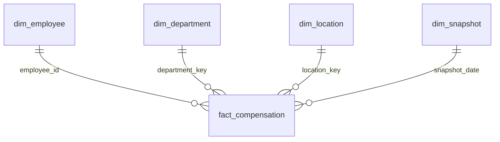

# Power BI Desktop integration

These are editable **Power BI source/model files**, not a finished `.pbix` report. PostgreSQL and export paths are tested in Linux; M/DAX/Tabular model execution and report assembly require Power BI Desktop on Windows and have not been run here. No cloud workspace or paid service is required for local Desktop work.

## 1. Start PostgreSQL on the same machine as Desktop

From the repository root, after Python setup:

```bash
python -m etl.dev_database
python -m etl.warehouse
python -m etl.bi_reader
```

Docker Desktop must be running. The database is bound to `127.0.0.1:15432`; database name is `payroll`. The helper generates random passwords in ignored `.env` (do not commit it). In Power BI, authenticate using `PAYROLL_BI_USER` and `PAYROLL_BI_PASSWORD` from your local `.env`. This role can read but cannot modify the warehouse. The owner account is for ETL, not reporting.

The cloud task's localhost is **not** the Windows PC's localhost. To use this exact cloud dataset without exposing a database, export CSVs with `python -m etl.export_bi` and transfer the files from `data/generated/powerbi/` to your PC, or clone/run the project locally. For a deployed database, use its reachable hostname and TLS configuration. Do not publish the local Docker port to the Internet. No gateway or Power BI Service refresh has been configured.

## 2. Import the star schema (recommended Desktop route)

1. In Desktop, choose **Get data → PostgreSQL database**. Server: `localhost:15432`; database: `payroll`; mode: **Import**. Use the read-only credentials in the credential dialog, never inside M code.
2. Load `payroll_analytics.dim_department`, `dim_location`, `dim_employee`, `dim_snapshot`, and `bi_fact_compensation`.
3. Rename the imported queries to the dimension names above and rename `bi_fact_compensation` to **fact_compensation**.
4. Confirm salary columns are Fixed Decimal Number, keys are Whole Number, and hire/snapshot dates are Date. Disable automatic relationship detection if it creates extra relationships.
5. Add the four **one-to-many**, **single-direction** relationships below (dimension filters fact). Use active relationships and ensure each dimension key is unique.
6. Add the measures from `measures.dax` individually to `fact_compensation`; set currency/percentage formats. Do not sum annual salaries in mixed local currencies; use USD measures.
7. Import `theme.json` via **View → Themes → Browse for themes**, then build the three pages in `report-spec.json`. Save as `PayrollAnalytics.pbix` on your PC.

| One side | Many side |
|---|---|
| dim_employee.employee_id | fact_compensation.employee_id |
| dim_department.department_key | fact_compensation.department_key |
| dim_location.location_key | fact_compensation.location_key |
| dim_snapshot.snapshot_date | fact_compensation.snapshot_date |



`PayrollSource.pq` is an alternative reusable Power Query entry point: paste into a blank query named `PayrollSource`, disable its load, then create five reference queries, e.g. `= PayrollSource[dim_employee]` and `= PayrollSource[fact_compensation]`. Set its server/database first; credentials still belong in Desktop's credential dialog.

`PayrollAnalytics.bim` defines the same five tables, M import partitions, relationships and DAX measures as a Tabular Object Model source for tools such as Tabular Editor. It is **not directly opened as a `.pbix`**. For a straightforward Desktop workflow, use the import steps above. The BIM's `PgServer` and `PgDatabase` expressions are configurable; there are no stored credentials. It has been structurally checked against the actual PostgreSQL columns, not compiled in Analysis Services.

## CSV fallback

For a single file handoff, run `python -m etl.package_bi` and transfer `data/generated/PayrollAnalytics_PowerBI.zip` to Windows. Unzip and start with `START_HERE.md`. No passwords or environment files are included.

`python -m etl.export_bi` creates CSVs plus a row-count manifest. Import the five star-model CSVs with matching names and create the same relationships/measures. Set key/date/numeric types explicitly. Additional KPI, department and benchmark CSVs are useful for reconciliation; keep them disconnected from the star model to avoid double counting.

## KPI definitions and reconciliation

- Grain: **one employee at the latest loaded snapshot**, not a salary payment or monthly payroll transaction.
- Headcount: fact row count (50,000 with the default fixture). Countries have 25,000 employees each.
- Annual salary run rate: sum of annual salaries in USD, excluding benefits, taxes, bonuses and overtime.
- Monthly salary equivalent: annual salary run rate / 12, not paid monthly payroll.
- Remote share: remote headcount / filtered headcount; Hybrid is a separate arrangement.
- Median and P90 are recalculated over the filtered facts; never average departmental medians.
- Department salary share removes department filters while retaining country and other filters.
- There is no attrition, pay-gap-by-gender, actual-vs-budget or period-over-period KPI because the source does not support those measures.

Compare cards with `SELECT * FROM payroll_analytics.v_payroll_kpis` and departmental totals with `v_department_country`. Refresh after ETL; values should match SQL in the same snapshot. The default snapshot is 2026-10-23. Historical dimension changes use Type 1 updates; this is a current-state model, not a full slowly changing employee history.
